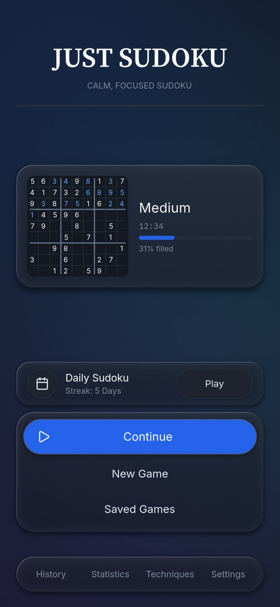
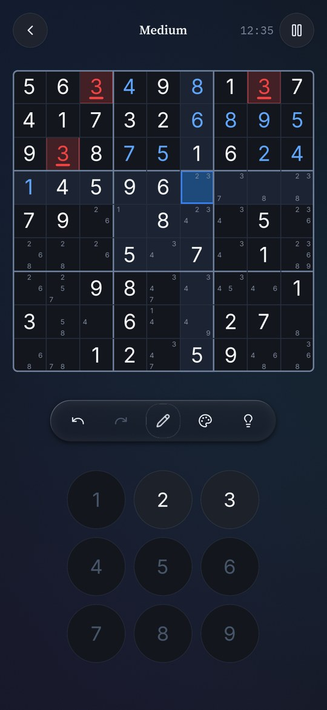
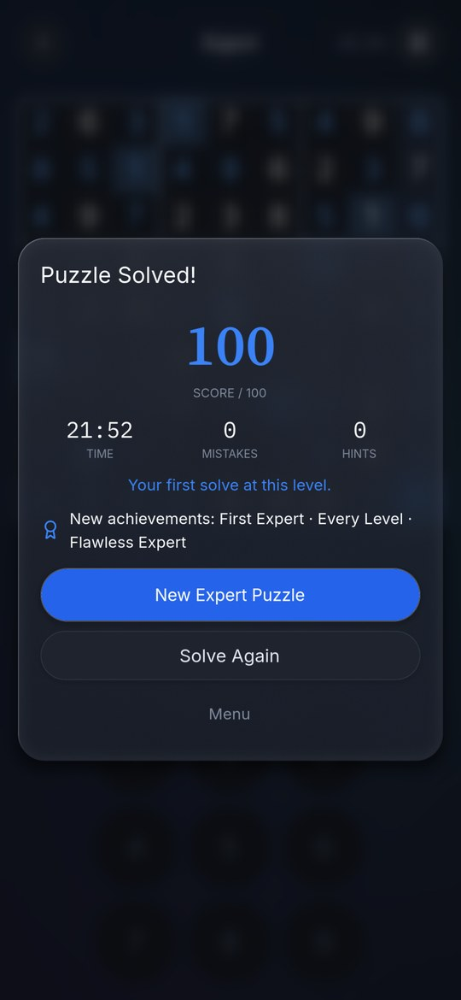
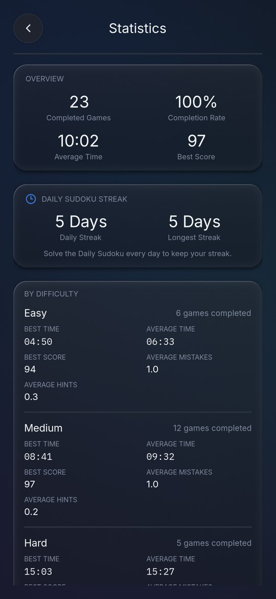
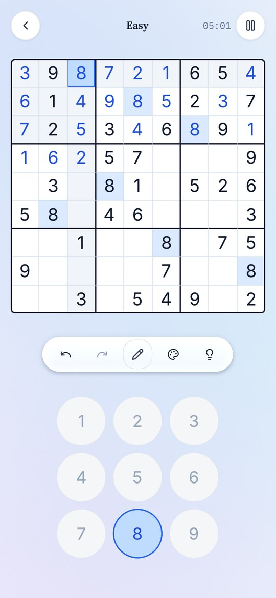
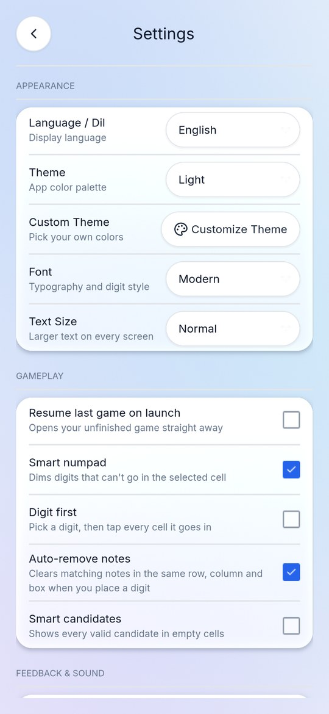
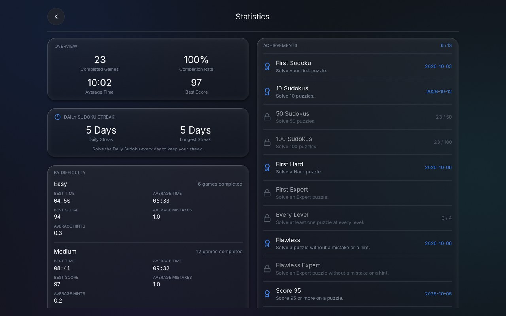

# Just Sudoku

**A calm, focused Sudoku: no ads, no account, no internet, nothing collected. Free and open source.**

[](https://github.com/r0madeus/just-sudoku/actions/workflows/tests.yml)
[](https://github.com/r0madeus/just-sudoku/actions/workflows/android.yml)
[](LICENSE)

[Türkçe](README.tr.md)

<p>
  
  
  
  
</p>

## Features

**Puzzles**
- Four levels (Easy, Medium, Hard, Expert), rated by the techniques a person needs to solve them: from Naked Singles to X-Wing, Swordfish, XYZ-Wing, Simple Coloring and XY-Chain. Every puzzle has exactly one solution and can be solved by logic alone, without guessing, so a hint can always explain the next step.
- A new puzzle opens at once. Medium, Hard and Expert come from a bank of puzzles rated in advance, each shown in a different disguise (digits relabelled, rows and columns shuffled), which keeps its difficulty exactly.
- **Daily Sudoku**: the same puzzle for everyone each day, with a streak. A calendar keeps the last year: play any day you missed (only days solved on the day count for the streak).
- Replay any puzzle from your history, or share it as a number or an 81-character code and import someone else's.

**Solving**
- Notes, with *Fill notes*, automatic note removal and optional smart candidates.
- Undo and redo, a number pad that dims the digits that cannot go in the selected cell, and clash highlighting.
- Your way of entering digits: pick the cell first or the digit first, drag over several cells to note a digit in all of them at once, and mark cells with nine colours.
- Hints in three steps: where to look, which technique, then the move itself. A step-by-step solution viewer when you are stuck.
- A **Techniques guide**: every technique the levels are rated by, explained in plain words and shown on a real board, with the move played for you and practice puzzles that need it.
- Check the board, or have wrong digits shown as you place them.

**Progress**
- A score out of 100 for each solve (time, mistakes, hints), with your record and average at each level.
- History with filters, statistics per level, and 13 quiet achievements.
- Unfinished games are saved as you play, and several can be kept side by side.
- Back up everything (history, statistics, achievements, saved games, settings) to a file or the clipboard, and restore it on a new phone.

**For everyone**
- Five themes (Dark, AMOLED, Light, Sepia, Forest) plus your own colours; three typefaces.
- Quiet sounds made in code (no audio files): a soft marimba note for each digit, rising from 1 to 9, lighter taps for notes, bells when a row, column or box is done. They can be turned off.
- Text size setting; wrong digits are marked by shape as well as colour, for colour-blind players; the text in every built-in theme meets WCAG AA contrast.
- Not yet for screen readers: Godot, the engine the game is made with, does not expose its screens to TalkBack on Android yet.
- English and Turkish.
- Phone and tablet layouts, including side-by-side layouts on a tablet in landscape.

<p>
  
  
</p>


## Privacy

Just Sudoku asks for no permission except vibration. It has no internet permission at all, so it cannot send anything anywhere: no ads, no analytics, no account. Your games, history and settings stay on your device (Android backup is off as well). The full privacy note: [PRIVACY.md](PRIVACY.md). To move to another device, back everything up in Settings → Data and restore it there; a single game can also be exported and imported.

## Download

Version 1.0.0, for Android 7.0 and up (64-bit ARM).

- **APK:** from the [Releases](https://github.com/r0madeus/just-sudoku/releases) page, with its SHA-256 checksum. What changed in each version: [CHANGELOG.md](CHANGELOG.md).
- **F-Droid:** on its way ([docs/fdroid.md](docs/fdroid.md)).
- Test builds of every change are under *Artifacts* in [Android APK (slim engine)](https://github.com/r0madeus/just-sudoku/actions/workflows/android.yml) runs (signed with a test key, for trying out). Installing on a phone and a checklist of what to try: [docs/android.md](docs/android.md). How a release is made: [docs/release.md](docs/release.md).

## Building from source

1. Install [Godot 4.7](https://godotengine.org/download/archive/) (the standard build; the project uses the Compatibility renderer).
2. Open `project.godot` in Godot and press *Run*. It runs on Linux, Windows and macOS as well, which is handy for development.
3. For Android, export from *Project → Export → Android*; setup and signing are in [docs/android.md](docs/android.md).

The Android build uses a Godot export template built with only what the game needs ([engine/custom.py](engine/custom.py)): no 3D, physics, Vulkan or unused modules. That halves the APK, from 28.2 MB to 14.5 MB. GitHub builds the template and the APK automatically; how to build it yourself is in [docs/android.md](docs/android.md#küçültülmüş-motor-daha-küçük-apk).

## Tests

```
GODOT=/path/to/godot tools/run_tests.sh
```

Runs all 58 test suites, four at a time, each with its own empty save folder (under a minute). They also run on every pull request. [docs/testing.md](docs/testing.md) explains them, and how `tools/mutation_audit.py` checks that the tests really catch mistakes: it breaks 102 behaviours one at a time and all 102 are caught.

## Project layout

| Folder | What is in it |
|---|---|
| `scripts/core/` | Sudoku itself: board, solver, generator, difficulty rating |
| `scripts/gameplay/` | A game in progress: moves, hints, undo, timer, score |
| `scripts/data/` | Saved games, history, statistics, Daily Sudoku, achievements |
| `scripts/services/` | Theme, fonts, translations, layout, sound, sharing |
| `scenes/` | Screens and UI components (built in code) |
| `assets/` | Fonts, icons, app icon |
| `tests/` | The test suites |
| `engine/` | The slimmed Godot build profile for Android |
| `tools/` | Test runner, mutation audit, puzzle bank and technique examples, screenshots |
| `docs/` | Android, testing, releases, F-Droid |
| `fastlane/` | Store texts, icon and screenshots (also used by this README) |

`Just Sudoku GDD.md` is the first design document (in Turkish); it is out of date and does not describe the game as it is now. `addons/godot_mcp/` is an editor add-on used during development; it is not part of the game.

## Contributing

Issues and pull requests are welcome. Please keep to what makes the game what it is: calm, offline, no ads or tracking. A change comes with tests (and the suites pass), and new text comes in both English and Turkish.

## License

Just Sudoku is free software under the [GNU General Public License v3.0](LICENSE).

It uses:
- [Godot Engine](https://godotengine.org) (MIT)
- The fonts [Inter](https://rsms.me/inter/), [Nunito](https://github.com/googlefonts/nunito), [Source Serif 4](https://github.com/adobe-fonts/source-serif), [DM Serif Display](https://github.com/googlefonts/dm-fonts) and [IBM Plex Mono](https://github.com/IBM/plex), under the SIL Open Font License ([assets/fonts/licenses](assets/fonts/licenses))
- [Lucide](https://lucide.dev) icons (ISC, [assets/icons/LICENSE-lucide.txt](assets/icons/LICENSE-lucide.txt))
