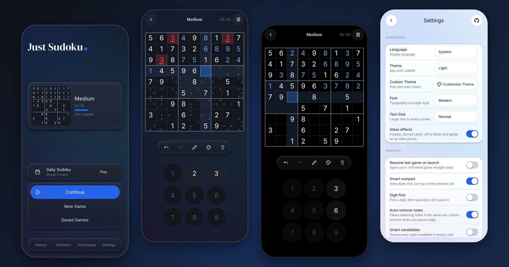
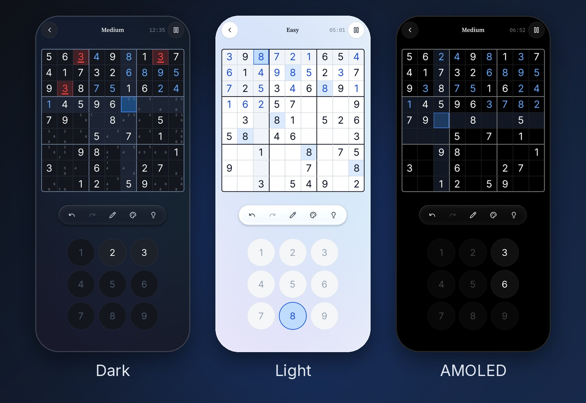
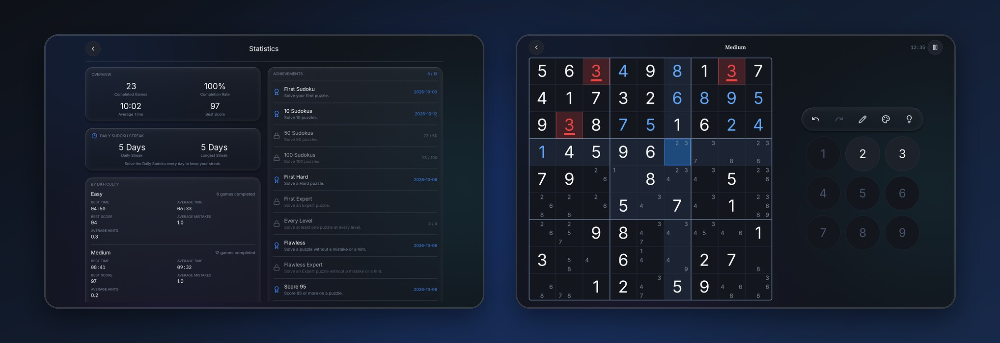

<p align="center">
  
</p>

<h1 align="center">Just Sudoku</h1>

<p align="center">
  <b>A calm, focused Sudoku.</b><br>
  No ads, no account, no internet, nothing collected. Free and open source.
</p>

<p align="center">
  <a href="https://r0madeus.github.io/just-sudoku/"><b>Play in your browser</b></a> ·
  <a href="#get-it">Download</a> ·
  <a href="CHANGELOG.md">What's new</a> ·
  <a href="README.tr.md">Türkçe</a>
</p>

<p align="center">
  <a href="https://github.com/r0madeus/just-sudoku/actions/workflows/tests.yml"></a>
  <a href="https://github.com/r0madeus/just-sudoku/actions/workflows/android.yml"></a>
  <a href="https://github.com/r0madeus/just-sudoku/actions/workflows/windows.yml"></a>
  <a href="https://github.com/r0madeus/just-sudoku/actions/workflows/linux.yml"></a>
  <a href="https://github.com/r0madeus/just-sudoku/actions/workflows/web.yml"></a>
  <a href="LICENSE"></a>
</p>

<p align="center">
  
</p>

## Get it

| | |
|---|---|
| **Browser** | Play now at **<https://r0madeus.github.io/just-sudoku/>**. On a phone or in Chrome/Edge it can be installed as an app (browser menu → *Install app* / *Add to Home screen*) and then works offline. Progress stays in the browser; back up in Settings to a file or the clipboard. |
| **Android** | `JustSudoku-<version>.apk` on the [Releases](https://github.com/r0madeus/just-sudoku/releases) page, with its SHA-256 (Android 7.0 and up, 64-bit ARM). F-Droid is on its way ([docs/fdroid.md](docs/fdroid.md)). |
| **Windows** | `JustSudoku-<version>-windows-x64.zip` on Releases: one exe, no install. It is not code-signed, so SmartScreen asks once: *More info* → *Run anyway*. |
| **Linux** | On Releases: an **AppImage** (one file; `chmod +x` and run) and a **tar.gz** (unpack, `./JustSudoku`). Both 64-bit, for glibc 2.35 or newer (Ubuntu 22.04, Debian 12, Fedora 36); how they are made: [docs/linux.md](docs/linux.md). |

What changed in each version: [CHANGELOG.md](CHANGELOG.md). Test builds of every change are under *Artifacts* in the [Android](https://github.com/r0madeus/just-sudoku/actions/workflows/android.yml) runs (signed with a test key); installing on a phone and a checklist of what to try: [docs/android.md](docs/android.md). How a release is made: [docs/release.md](docs/release.md).

## Latest changes

- **Linux:** AppImage and tar.gz, built and started by CI on every change.
- **Settings:** on/off switches that slide, instead of check boxes; a *Glass effects* setting (off draws the cards flat, lighter on an older phone); a link to this page in the corner.
- **Browser:** back up to a file and restore from one, a loading screen with the game's name, and a note that progress stays in the browser.
- **Look:** a truly black AMOLED theme, round on/off buttons for notes and colours, a pencil for notes, clean edges on the blue buttons, plainer wording ("complete" instead of "filled").
- **Fixed:** on a touch screen a tap on a digit key put the digit in and took it out again.

The full list is in [CHANGELOG.md](CHANGELOG.md).

## Features

**Puzzles**
- Four levels (Easy, Medium, Hard, Expert), rated by the techniques a person needs to solve them: from Naked Singles to X-Wing, Swordfish, XYZ-Wing, Simple Coloring and XY-Chain. Every puzzle has exactly one solution and can be solved by logic alone, without guessing, so a hint can always explain the next step.
- A new puzzle opens at once. Medium, Hard and Expert come from a bank of puzzles rated in advance, each shown in a different disguise (digits relabelled, rows and columns shuffled), which keeps its difficulty exactly.
- **Daily Sudoku**: the same puzzle for everyone each day, with a streak. A calendar keeps the last year: play any day you missed (only days solved on the day count for the streak).
- Replay any puzzle from your history, or share it as a number or an 81-character code and import someone else's.

**Solving**
- Notes, with *Fill notes*, automatic note removal and optional smart candidates.
- Undo and redo, a number pad that dims the digits that cannot go in the selected cell, and clash highlighting.
- Your way of entering digits: pick the cell first or the digit first, drag over several cells to note a digit in all of them at once, and mark cells with nine colours.
- Hints in three steps: where to look, which technique, then the move itself. A step-by-step solution viewer when you are stuck.
- A **Techniques guide**: every technique the levels are rated by, explained in plain words and shown on a real board, with the move played for you and practice puzzles that need it.
- Check the board, or have wrong digits shown as you place them.

**Progress**
- A score out of 100 for each solve (time, mistakes, hints), with your record and average at each level.
- History with filters, statistics per level, and 13 quiet achievements.
- Unfinished games are saved as you play, and several can be kept side by side.
- Back up everything (history, statistics, achievements, saved games, settings) to a file or the clipboard, and restore it on a new device. In the browser the file is a download and the restore opens the browser's own file window.

**For everyone**
- Five themes (Dark, AMOLED, Light, Sepia, Forest) plus your own colours; three typefaces. AMOLED is truly black, so its pixels stay off. *Glass effects* can be turned off for flatter cards that are lighter to draw.
- Plays on Android, in a browser (installable as an app, works offline), on Windows and on Linux.
- Quiet sounds made in code (no audio files): a soft marimba note for each digit, rising from 1 to 9, lighter taps for notes, bells when a row, column or box is done. They can be turned off.
- Text size setting; wrong digits are marked by shape as well as colour, for colour-blind players; the text in every built-in theme meets WCAG AA contrast.
- Not yet for screen readers: Godot, the engine the game is made with, does not expose its screens to TalkBack on Android yet.
- English and Turkish.
- Phone and tablet layouts, including side-by-side layouts on a tablet in landscape.

<p align="center">
  
</p>
<p align="center">
  
</p>

## Privacy

Just Sudoku asks for no permission except vibration. It has no internet permission at all, so it cannot send anything anywhere: no ads, no analytics, no account. Your games, history and settings stay on your device (Android backup is off as well). The full privacy note: [PRIVACY.md](PRIVACY.md). The browser version keeps its data in the browser's own storage and sends nothing either. To move to another device, back everything up in Settings → Data and restore it there; a single game can also be exported and imported.

## Building from source

1. Install [Godot 4.7](https://godotengine.org/download/archive/) (the standard build; the project uses the Compatibility renderer).
2. Open `project.godot` in Godot and press *Run*. It runs on Linux, Windows and macOS as well, which is handy for development.
3. For Android, export from *Project → Export → Android*; setup and signing are in [docs/android.md](docs/android.md). The Windows, Linux and Web exports have presets too (*Project → Export*); the Linux packages are described in [docs/linux.md](docs/linux.md).

Every build (Android, browser, Windows and Linux) uses a Godot export template built with only what the game needs ([engine/custom.py](engine/custom.py)): no 3D, physics, Vulkan or unused modules. That halves the APK, from 28.2 MB to 14.5 MB, and makes the other engines much smaller too. GitHub builds the templates and the games automatically, and each run says how much smaller the engine is than the official one; the details are in [docs/engine.md](docs/engine.md).

## Tests

```
GODOT=/path/to/godot tools/run_tests.sh
```

Runs all 69 test suites, four at a time, each with its own empty save folder (under a minute). They also run on every pull request. [docs/testing.md](docs/testing.md) explains them, and how `tools/mutation_audit.py` checks that the tests really catch mistakes: it breaks 151 behaviours one at a time and all 151 are caught.

## Project layout

| Folder | What is in it |
|---|---|
| `scripts/core/` | Sudoku itself: board, solver, generator, difficulty rating |
| `scripts/gameplay/` | A game in progress: moves, hints, undo, timer, score |
| `scripts/data/` | Saved games, history, statistics, Daily Sudoku, achievements |
| `scripts/services/` | Theme, fonts, translations, layout, sound, sharing |
| `scenes/` | Screens and UI components (built in code) |
| `assets/` | Fonts, icons, app icon |
| `packaging/` | Linux menu entry, store description and icons |
| `web/` | The browser version's page (its loading screen) |
| `tests/` | The test suites |
| `engine/` | The slimmed Godot build profile (used by every build) |
| `tools/` | Test runner, mutation audit, puzzle bank and technique examples, screenshots, Linux packages |
| `docs/` | The engine, Android, web, Linux, testing, releases, F-Droid, and the pictures in this README |
| `fastlane/` | Store texts, icon and screenshots (also used by this README) |

`Just Sudoku GDD.md` is the first design document (in Turkish); it is out of date and does not describe the game as it is now.

## Contributing

Issues and pull requests are welcome. Please keep to what makes the game what it is: calm, offline, no ads or tracking. A change comes with tests (and the suites pass), and new text comes in both English and Turkish.

## License

Just Sudoku is free software under the [GNU General Public License v3.0](LICENSE).

It uses:
- [Godot Engine](https://godotengine.org) (MIT)
- The fonts [Inter](https://rsms.me/inter/), [Nunito](https://github.com/googlefonts/nunito), [Source Serif 4](https://github.com/adobe-fonts/source-serif), [DM Serif Display](https://github.com/googlefonts/dm-fonts) and [IBM Plex Mono](https://github.com/IBM/plex), under the SIL Open Font License ([assets/fonts/licenses](assets/fonts/licenses))
- [Lucide](https://lucide.dev) icons (ISC) and the GitHub mark from [Simple Icons](https://simpleicons.org) (CC0), both in [assets/icons/LICENSE-lucide.txt](assets/icons/LICENSE-lucide.txt)
