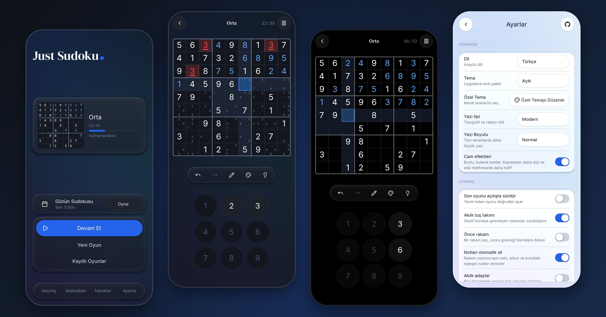
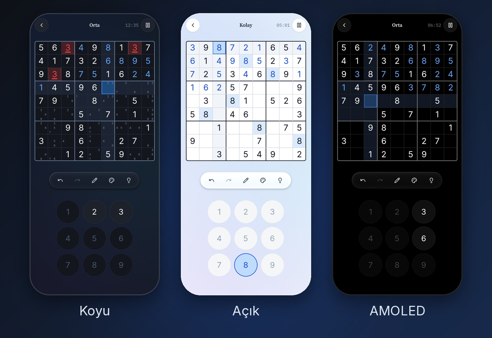
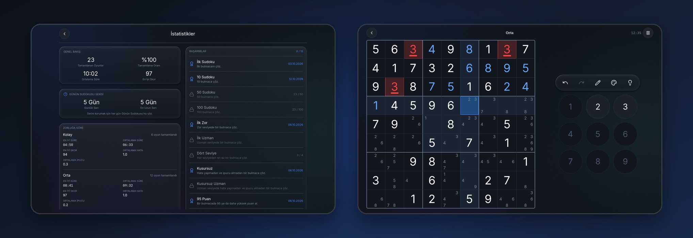

<p align="center">
  
</p>

<h1 align="center">Just Sudoku</h1>

<p align="center">
  <b>Sakin, odaklı bir Sudoku.</b><br>
  Reklam yok, hesap yok, internet yok, hiçbir veri toplanmıyor. Ücretsiz ve açık kaynak.
</p>

<p align="center">
  <a href="https://r0madeus.github.io/just-sudoku/"><b>Tarayıcıda oyna</b></a> ·
  <a href="#indirme">İndir</a> ·
  <a href="CHANGELOG.md">Neler yeni</a> ·
  <a href="README.md">English</a>
</p>

<p align="center">
  <a href="https://github.com/r0madeus/just-sudoku/actions/workflows/tests.yml"></a>
  <a href="https://github.com/r0madeus/just-sudoku/actions/workflows/android.yml"></a>
  <a href="https://github.com/r0madeus/just-sudoku/actions/workflows/windows.yml"></a>
  <a href="https://github.com/r0madeus/just-sudoku/actions/workflows/linux.yml"></a>
  <a href="https://github.com/r0madeus/just-sudoku/actions/workflows/web.yml"></a>
  <a href="LICENSE"></a>
</p>

<p align="center">
  
</p>

<a id="indirme"></a>

## İndirme

| | |
|---|---|
| **Tarayıcı** | Hemen oyna: **<https://r0madeus.github.io/just-sudoku/>**. Telefonda veya Chrome/Edge'de uygulama olarak yüklenebilir (tarayıcı menüsü → *Uygulamayı yükle* / *Ana ekrana ekle*), yüklenince çevrimdışı da çalışır. İlerleme tarayıcıda kalır; Ayarlar'dan dosyaya ya da panoya yedekle. |
| **Android** | [Releases](https://github.com/r0madeus/just-sudoku/releases) sayfasında `JustSudoku-<sürüm>.apk`, SHA-256 özetiyle (Android 7.0 ve üstü, 64-bit ARM). F-Droid yolda ([docs/fdroid.md](docs/fdroid.md)). |
| **Windows** | Releases'ta `JustSudoku-<sürüm>-windows-x64.zip`: tek exe, kurulum yok. İmzalı değil; SmartScreen bir kez sorar: *Ek bilgi* → *Yine de çalıştır*. |
| **Linux** | Releases'ta: bir **AppImage** (tek dosya; `chmod +x` yapıp çalıştır) ve bir **tar.gz** (aç, `./JustSudoku`). İkisi de 64-bit, glibc 2.35 ya da yenisi için (Ubuntu 22.04, Debian 12, Fedora 36); nasıl yapıldıkları: [docs/linux.md](docs/linux.md). |

Her sürümde neyin değiştiği: [CHANGELOG.md](CHANGELOG.md). Her değişikliğin deneme sürümü [Android](https://github.com/r0madeus/just-sudoku/actions/workflows/android.yml) çalıştırmalarının *Artifacts* bölümünde (test anahtarıyla imzalı); telefona kurulum ve denenecekler listesi: [docs/android.md](docs/android.md). Sürüm nasıl yayınlanır: [docs/release.md](docs/release.md).

## Son değişiklikler

- **Linux:** AppImage ve tar.gz; CI her değişiklikte derleyip başlatıp deniyor.
- **Ayarlar:** onay kutuları yerine kayan açma/kapama anahtarları; *Cam efektleri* ayarı (kapalıyken kartlar düz çizilir, eski telefonda daha hafif); köşede bu sayfaya bir bağlantı.
- **Tarayıcı:** dosyaya yedekleme ve dosyadan geri yükleme, oyunun adını gösteren yükleme ekranı ve ilerlemenin tarayıcıda kaldığını söyleyen bir not.
- **Görünüm:** gerçekten siyah AMOLED teması, Notlar ve Renkler için yuvarlak açma/kapama düğmeleri, not için kalem, mavi düğmelerde temiz kenarlar, daha sade metinler ("dolu" yerine "tamamlandı").
- **Düzeltildi:** dokunmatik ekranda sayı tuşuna basınca sayı girilip hemen siliniyordu.

Tam liste [CHANGELOG.md](CHANGELOG.md) dosyasında.

## Özellikler

**Bulmacalar**
- Dört seviye (Kolay, Orta, Zor, Uzman). Seviye, bulmacayı çözmek için gereken tekniklere göre belirleniyor: Açık Tekli'den X-Wing, Swordfish, XYZ-Wing, Basit Boyama ve XY-Zinciri'ne kadar. Her bulmacanın tek bir çözümü var ve tahmin gerektirmeden, yalnızca mantıkla çözülebiliyor; bu yüzden ipucu her adımı açıklayabiliyor.
- Yeni bulmaca anında açılıyor. Orta, Zor ve Uzman bulmacalar önceden derecelendirilmiş bir bankadan geliyor; her biri farklı bir kılıkta gösteriliyor (rakamlar yeniden adlandırılıyor, satır ve sütunlar karıştırılıyor), zorluğu ise aynen korunuyor.
- **Günün Sudokusu:** Her gün herkes için aynı bulmaca, seriyle birlikte. Takvimde son bir yılın bulmacaları duruyor: kaçırdığın günleri istediğin zaman oyna (seriye yalnızca gününde çözülenler sayılır).
- Geçmişteki bir bulmacayı yeniden çözebilir, bir sayı ya da 81 karakterlik bir kodla paylaşabilir, başkasınınkini içe aktarabilirsin.

**Çözerken**
- Notlar: *Notları doldur*, notların otomatik silinmesi ve isteğe bağlı akıllı adaylar.
- Geri al ve yinele. Seçili hücreye girmeyen rakamları soluklaştıran tuş takımı. Çakışan rakamların vurgulanması.
- Rakam girme biçimi senin: önce hücreyi ya da önce rakamı seç, birkaç hücrenin üzerinden sürükleyip hepsine aynı anda not al, hücreleri dokuz renkle işaretle.
- Üç adımlı ipucu: önce nereye bakacağın, sonra hangi teknik, en son hamlenin kendisi. Takıldığında adım adım çözüm gösterimi.
- **Teknikler rehberi:** Seviyelerin dayandığı her teknik sade bir dille anlatılıyor ve gerçek bir tahtada gösteriliyor; hamleyi sana oynatıyor ve o tekniği gerektiren alıştırma bulmacaları sunuyor.
- Tahtayı kontrol et ya da yanlış rakamlar girildiği anda gösterilsin.

**İlerleme**
- Her çözüme 100 üzerinden puan (süre, hata, ipucu). Her seviyedeki rekorun ve ortalamanla karşılaştırma.
- Filtrelenebilir geçmiş, seviye bazında istatistikler ve 13 sade başarım.
- Yarım kalan oyunlar sen oynarken kaydediliyor; birden fazla oyun yan yana tutulabiliyor.
- Her şeyi (geçmiş, istatistikler, başarımlar, kayıtlı oyunlar, ayarlar) bir dosyaya ya da panoya yedekleyip yeni cihazında geri yükleyebilirsin. Tarayıcıda dosya bir indirme olarak iner, geri yüklerken tarayıcının kendi dosya penceresi açılır.

**Herkes için**
- Beş tema (Koyu, AMOLED, Açık, Sepya, Orman) ve kendi renklerin; üç yazı tipi. AMOLED gerçekten siyah, yani pikselleri kapalı kalıyor. *Cam efektleri* kapatılıp daha düz, çizmesi daha hafif kartlar elde edilebilir.
- Android'de, tarayıcıda (uygulama olarak yüklenebilir, çevrimdışı çalışır), Windows'ta ve Linux'ta oynanıyor.
- Kodla üretilen sakin sesler (ses dosyası yok): her rakama 1'den 9'a yükselen yumuşak bir marimba notası, notlar için daha hafif dokunuşlar, bir satır, sütun ya da kutu tamamlanınca çan sesi. İstersen kapatabilirsin.
- **Erişilebilirlik:**
  - Yazı boyutu ayarı.
  - Renk körü oyuncular için yanlış rakamlar renkle birlikte şekille de işaretleniyor.
  - Bütün yerleşik temalarda yazılar WCAG AA kontrast seviyesini karşılıyor.
  - Ekran okuyucular için henüz değil: oyunun yapıldığı Godot motoru, Android'de ekranlarını TalkBack'e henüz açmıyor.
- Türkçe ve İngilizce.
- Telefon ve tablet düzenleri; yatay tablette yan yana düzenler.

<p align="center">
  
</p>
<p align="center">
  
</p>

## Gizlilik

Just Sudoku titreşim dışında hiçbir izin istemiyor.
- İnternet izni hiç yok; bu yüzden hiçbir yere bir şey gönderemez. Reklam, analiz aracı ya da hesap yok.
- Oyunların, geçmişin ve ayarların cihazında kalıyor; Android yedeklemesi de kapalı.
- Gizlilik notunun tamamı: [PRIVACY.md](PRIVACY.md).
- Tarayıcı sürümü de verilerini tarayıcının kendi deposunda tutar ve hiçbir yere bir şey göndermez.
- Başka bir cihaza geçerken Ayarlar → Veriler'den her şeyi yedekleyip orada geri yüklemen yeterli. Tek bir oyunu da dışa aktarıp içe aktarabilirsin.

## Kaynak koddan derleme

1. [Godot 4.7](https://godotengine.org/download/archive/) indir. Standart sürüm yeterli; proje Compatibility çiziciyi kullanıyor.
2. `project.godot` dosyasını Godot'da açıp *Çalıştır*'a bas. Linux, Windows ve macOS'ta da çalışır, geliştirirken işe yarar.
3. Android için *Proje → Dışa Aktar → Android* yolunu izle. Kurulum ve imzalama [docs/android.md](docs/android.md) dosyasında. Windows, Linux ve Web için de ön ayarlar var (*Proje → Dışa Aktar*); Linux paketleri [docs/linux.md](docs/linux.md) dosyasında anlatılıyor.

Her sürüm (Android, tarayıcı, Windows ve Linux), yalnızca oyunun ihtiyaç duyduklarıyla derlenmiş bir Godot şablonu kullanıyor ([engine/custom.py](engine/custom.py)). İçinde 3D, fizik, Vulkan ve kullanılmayan modüller yok; bu sayede APK 28,2 MB'tan 14,5 MB'a iniyor, diğer motorlar da çok daha küçük oluyor. Şablonları ve oyunları GitHub otomatik derliyor, her çalıştırma motorun resmî olandan ne kadar küçük olduğunu yazıyor; ayrıntılar [docs/engine.md](docs/engine.md) dosyasında.

## Testler

```
GODOT=/godot/yolu tools/run_tests.sh
```

69 test dosyasının hepsini dörder dörder, her birini kendi boş kayıt klasöründe çalıştırıyor (bir dakikadan kısa). Testler her PR'da da çalışıyor.

Ayrıntılar [docs/testing.md](docs/testing.md) dosyasında. Orada `tools/mutation_audit.py` aracı da anlatılıyor: oyunun 146 davranışını tek tek bilerek bozup testlerin bunu yakalayıp yakalamadığını kontrol ediyor. Şu an 146'inin 146'i yakalanıyor.

## Proje yapısı

| Klasör | İçinde ne var |
|---|---|
| `scripts/core/` | Sudoku'nun kendisi: tahta, çözücü, üretici, zorluk ölçümü |
| `scripts/gameplay/` | Süren oyun: hamleler, ipuçları, geri alma, süre, puan |
| `scripts/data/` | Kayıtlı oyunlar, geçmiş, istatistikler, Günün Sudokusu, başarımlar |
| `scripts/services/` | Tema, yazı tipleri, çeviriler, yerleşim, ses, paylaşım |
| `scenes/` | Ekranlar ve arayüz bileşenleri (kodla kuruluyor) |
| `assets/` | Yazı tipleri, simgeler, uygulama simgesi |
| `packaging/` | Linux menü girdisi, mağaza açıklaması ve simgeler |
| `web/` | Tarayıcı sürümünün sayfası (yükleme ekranı) |
| `tests/` | Test dosyaları |
| `engine/` | Küçültülmüş Godot derleme profili (her sürüm kullanır) |
| `tools/` | Test çalıştırıcı, mutasyon denetimi, bulmaca bankası ve teknik örnekleri, ekran görüntüleri, Linux paketleri |
| `docs/` | Motor, Android, web, Linux, testler, sürüm yayınlama, F-Droid ve bu README'deki resimler |
| `fastlane/` | Mağaza metinleri, simge ve ekran görüntüleri (bu README de onları kullanıyor) |

`Just Sudoku GDD.md` ilk tasarım belgesi; eski, oyunun bugünkü hâlini anlatmıyor.

## Katkı

Hata bildirimleri ve PR'lar memnuniyetle karşılanır. Lütfen oyunu oyun yapan şeylere sadık kal: sakin, çevrimdışı, reklamsız ve takipsiz.
- Her değişiklik testleriyle gelsin ve tüm testler geçsin.
- Yeni yazılar hem Türkçe hem İngilizce eklensin.

## Lisans

Just Sudoku, [GNU Genel Kamu Lisansı v3.0](LICENSE) altında özgür yazılımdır.

Kullandıkları:
- [Godot Engine](https://godotengine.org) (MIT)
- [Inter](https://rsms.me/inter/), [Nunito](https://github.com/googlefonts/nunito), [Source Serif 4](https://github.com/adobe-fonts/source-serif), [DM Serif Display](https://github.com/googlefonts/dm-fonts) ve [IBM Plex Mono](https://github.com/IBM/plex) yazı tipleri, SIL Open Font License ile ([assets/fonts/licenses](assets/fonts/licenses))
- [Lucide](https://lucide.dev) simgeleri (ISC) ve [Simple Icons](https://simpleicons.org)'tan GitHub işareti (CC0); ikisi de [assets/icons/LICENSE-lucide.txt](assets/icons/LICENSE-lucide.txt) dosyasında
