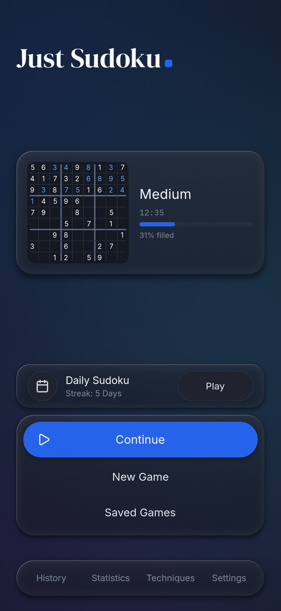
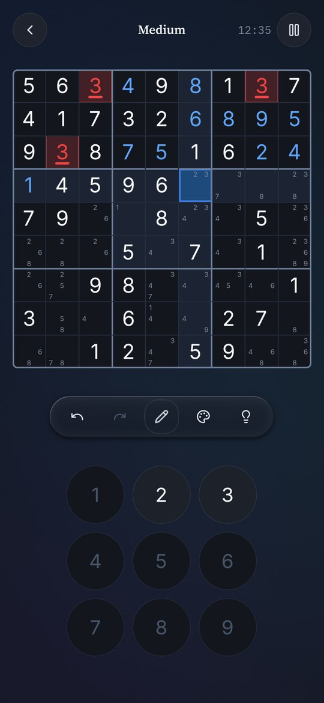
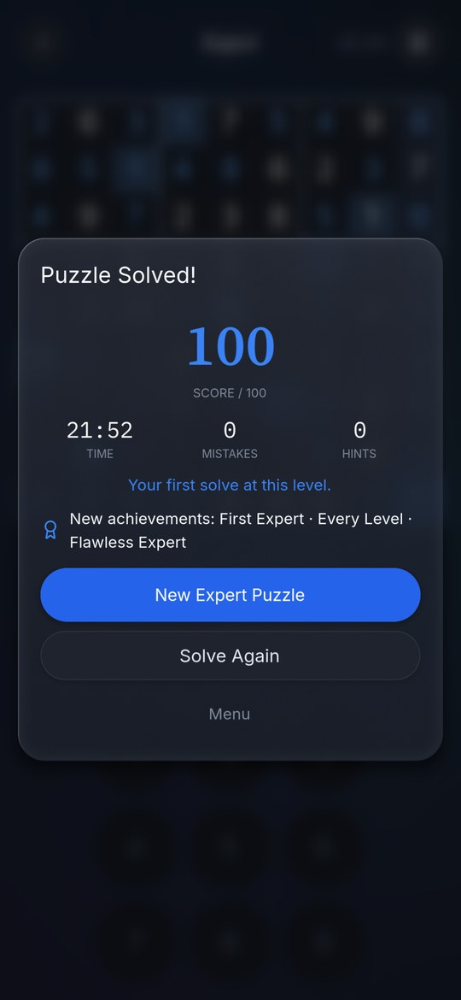
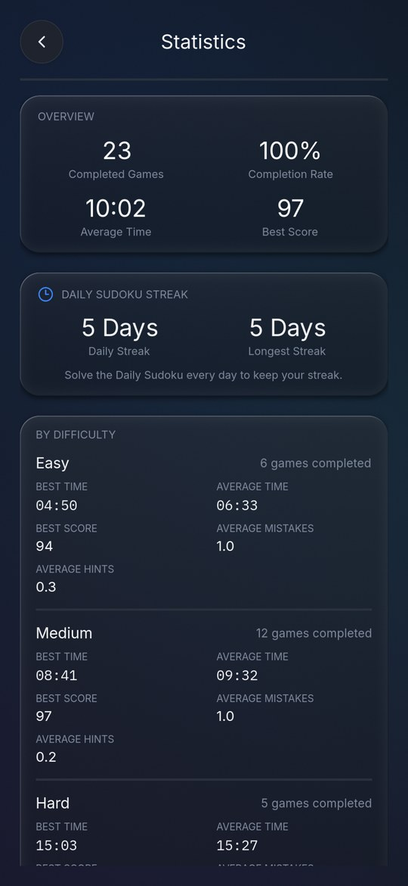
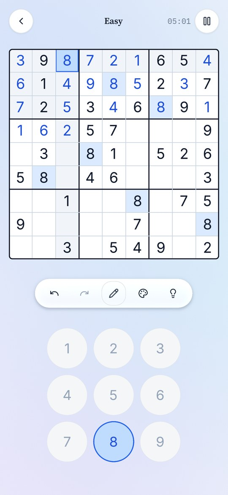
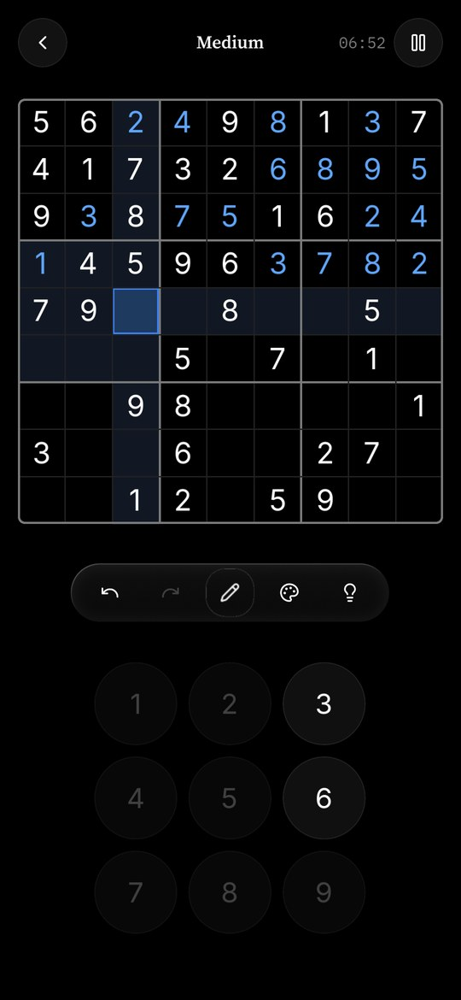
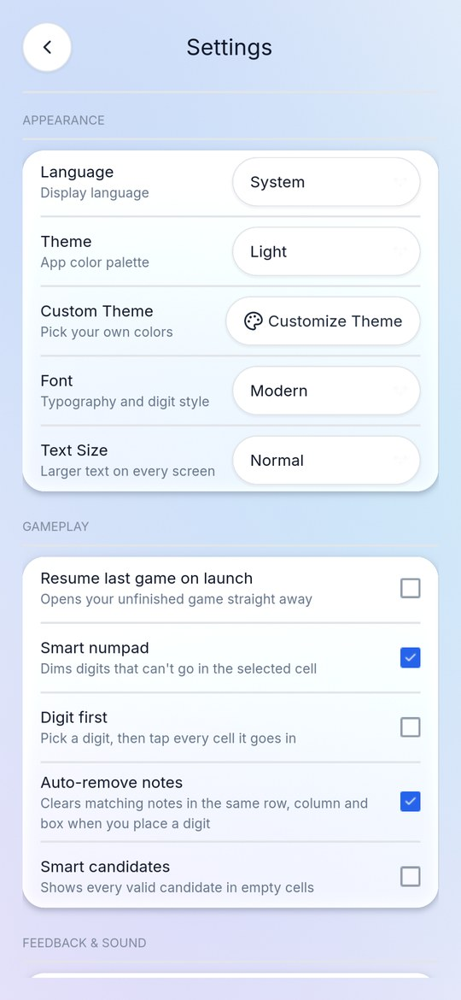
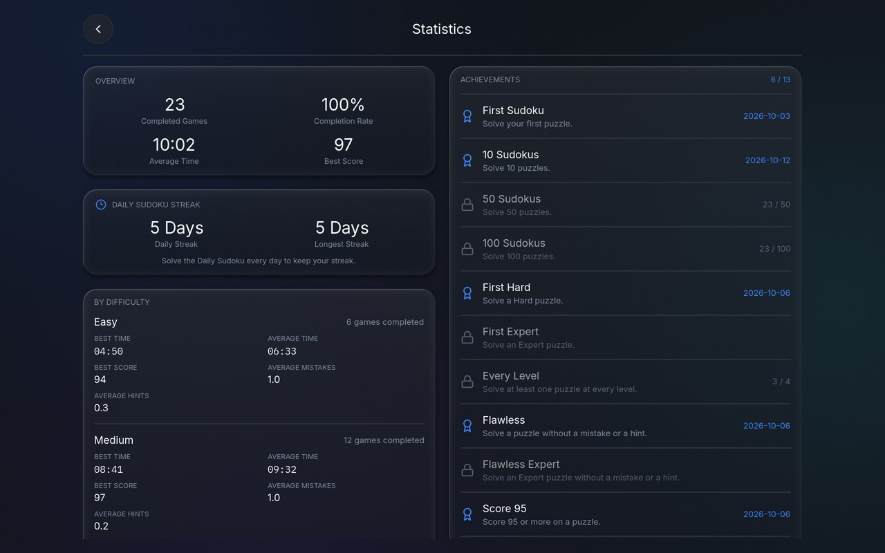

# Just Sudoku

**Sakin, odaklı bir Sudoku: reklam yok, hesap yok, internet yok, hiçbir veri toplanmıyor. Ücretsiz ve açık kaynak.**

[](https://github.com/r0madeus/just-sudoku/actions/workflows/tests.yml)
[](https://github.com/r0madeus/just-sudoku/actions/workflows/android.yml)
[](LICENSE)

[English](README.md)

<p>
  
  
  
  
</p>

## Özellikler

**Bulmacalar**
- Dört seviye (Kolay, Orta, Zor, Uzman). Seviye, bulmacayı çözmek için gereken tekniklere göre belirleniyor: Açık Tekli'den X-Wing, Swordfish, XYZ-Wing, Basit Boyama ve XY-Zinciri'ne kadar. Her bulmacanın tek bir çözümü var ve tahmin gerektirmeden, yalnızca mantıkla çözülebiliyor; bu yüzden ipucu her adımı açıklayabiliyor.
- Yeni bulmaca anında açılıyor. Orta, Zor ve Uzman bulmacalar önceden derecelendirilmiş bir bankadan geliyor; her biri farklı bir kılıkta gösteriliyor (rakamlar yeniden adlandırılıyor, satır ve sütunlar karıştırılıyor), zorluğu ise aynen korunuyor.
- **Günün Sudokusu:** Her gün herkes için aynı bulmaca, seriyle birlikte. Takvimde son bir yılın bulmacaları duruyor: kaçırdığın günleri istediğin zaman oyna (seriye yalnızca gününde çözülenler sayılır).
- Geçmişteki bir bulmacayı yeniden çözebilir, bir sayı ya da 81 karakterlik bir kodla paylaşabilir, başkasınınkini içe aktarabilirsin.

**Çözerken**
- Notlar: *Notları doldur*, notların otomatik silinmesi ve isteğe bağlı akıllı adaylar.
- Geri al ve yinele. Seçili hücreye girmeyen rakamları soluklaştıran tuş takımı. Çakışan rakamların vurgulanması.
- Rakam girme biçimi senin: önce hücreyi ya da önce rakamı seç, birkaç hücrenin üzerinden sürükleyip hepsine aynı anda not al, hücreleri dokuz renkle işaretle.
- Üç adımlı ipucu: önce nereye bakacağın, sonra hangi teknik, en son hamlenin kendisi. Takıldığında adım adım çözüm gösterimi.
- **Teknikler rehberi:** Seviyelerin dayandığı her teknik sade bir dille anlatılıyor ve gerçek bir tahtada gösteriliyor; hamleyi sana oynatıyor ve o tekniği gerektiren alıştırma bulmacaları sunuyor.
- Tahtayı kontrol et ya da yanlış rakamlar girildiği anda gösterilsin.

**İlerleme**
- Her çözüme 100 üzerinden puan (süre, hata, ipucu). Her seviyedeki rekorun ve ortalamanla karşılaştırma.
- Filtrelenebilir geçmiş, seviye bazında istatistikler ve 13 sade başarım.
- Yarım kalan oyunlar sen oynarken kaydediliyor; birden fazla oyun yan yana tutulabiliyor.
- Her şeyi (geçmiş, istatistikler, başarımlar, kayıtlı oyunlar, ayarlar) bir dosyaya ya da panoya yedekleyip yeni telefonunda geri yükleyebilirsin.

**Herkes için**
- Beş tema (Koyu, AMOLED, Açık, Sepya, Orman) ve kendi renklerin; üç yazı tipi. AMOLED gerçekten siyah, yani pikselleri kapalı kalıyor.
- Android'de, tarayıcıda (uygulama olarak yüklenebilir, çevrimdışı çalışır) ve Windows'ta oynanıyor.
- Kodla üretilen sakin sesler (ses dosyası yok): her rakama 1'den 9'a yükselen yumuşak bir marimba notası, notlar için daha hafif dokunuşlar, bir satır, sütun ya da kutu tamamlanınca çan sesi. İstersen kapatabilirsin.
- **Erişilebilirlik:**
  - Yazı boyutu ayarı.
  - Renk körü oyuncular için yanlış rakamlar renkle birlikte şekille de işaretleniyor.
  - Bütün yerleşik temalarda yazılar WCAG AA kontrast seviyesini karşılıyor.
  - Ekran okuyucular için henüz değil: oyunun yapıldığı Godot motoru, Android'de ekranlarını TalkBack'e henüz açmıyor.
- Türkçe ve İngilizce.
- Telefon ve tablet düzenleri; yatay tablette yan yana düzenler.

<p>
  
  
  
</p>


## Gizlilik

Just Sudoku titreşim dışında hiçbir izin istemiyor.
- İnternet izni hiç yok; bu yüzden hiçbir yere bir şey gönderemez. Reklam, analiz aracı ya da hesap yok.
- Oyunların, geçmişin ve ayarların cihazında kalıyor; Android yedeklemesi de kapalı.
- Gizlilik notunun tamamı: [PRIVACY.md](PRIVACY.md).
- Başka bir cihaza geçerken Ayarlar → Veriler'den her şeyi yedekleyip orada geri yüklemen yeterli. Tek bir oyunu da dışa aktarıp içe aktarabilirsin.

## İndirme

Sürüm 1.0.3; Android 7.0 ve üstü (64-bit ARM).

- **APK:** [Releases](https://github.com/r0madeus/just-sudoku/releases) sayfasından, SHA-256 özetiyle birlikte. Her sürümde neyin değiştiği: [CHANGELOG.md](CHANGELOG.md).
- **Tarayıcıda:** `main`'in her sürümü GitHub Pages'te yayınlanır: <https://r0madeus.github.io/just-sudoku/> (aynı derleme, [Web](https://github.com/r0madeus/just-sudoku/actions/workflows/web.yml) çalıştırmalarının *Artifacts* bölümünde zip olarak durur; itch.io'ya HTML5 oyunu olarak yüklenebilir). Telefonda veya Chrome/Edge'de uygulama olarak yüklenebilir (tarayıcı menüsü → *Uygulamayı yükle* / *Ana ekrana ekle*); yüklenince çevrimdışı da çalışır. İlerleme tarayıcının kendi deposunda tutulur, site verisi silinirse gider; Yedekleme (Ayarlar'da) panoya kopyalayarak çalışır.
- **Windows:** Releases sayfasında `JustSudoku-<sürüm>-windows-x64.zip` (64-bit, tek exe, kurulum yok). İmzalı değil; SmartScreen bir kez sorar: *Ek bilgi* → *Yine de çalıştır*.
- **F-Droid:** yolda ([docs/fdroid.md](docs/fdroid.md)).
- Her değişikliğin deneme sürümü [Android APK (slim engine)](https://github.com/r0madeus/just-sudoku/actions/workflows/android.yml) çalıştırmalarının *Artifacts* bölümünde (test anahtarıyla imzalı, denemek için). Telefona kurulum ve denenecekler listesi: [docs/android.md](docs/android.md). Sürüm nasıl yayınlanır: [docs/release.md](docs/release.md).

## Kaynak koddan derleme

1. [Godot 4.7](https://godotengine.org/download/archive/) indir. Standart sürüm yeterli; proje Compatibility çiziciyi kullanıyor.
2. `project.godot` dosyasını Godot'da açıp *Çalıştır*'a bas. Linux, Windows ve macOS'ta da çalışır, geliştirirken işe yarar.
3. Android için *Proje → Dışa Aktar → Android* yolunu izle. Kurulum ve imzalama [docs/android.md](docs/android.md) dosyasında.

Android sürümü, yalnızca oyunun ihtiyaç duyduklarıyla derlenmiş bir Godot şablonu kullanıyor ([engine/custom.py](engine/custom.py)). İçinde 3D, fizik, Vulkan ve kullanılmayan modüller yok; bu sayede APK 28,2 MB'tan 14,5 MB'a iniyor. Şablonu ve APK'yı GitHub otomatik derliyor. Kendin derlemek istersen yol [docs/android.md](docs/android.md#küçültülmüş-motor-daha-küçük-apk) dosyasında.

## Testler

```
GODOT=/godot/yolu tools/run_tests.sh
```

58 test dosyasının hepsini dörder dörder, her birini kendi boş kayıt klasöründe çalıştırıyor (bir dakikadan kısa). Testler her PR'da da çalışıyor.

Ayrıntılar [docs/testing.md](docs/testing.md) dosyasında. Orada `tools/mutation_audit.py` aracı da anlatılıyor: oyunun 102 davranışını tek tek bilerek bozup testlerin bunu yakalayıp yakalamadığını kontrol ediyor. Şu an 102'nin 102'si yakalanıyor.

## Proje yapısı

| Klasör | İçinde ne var |
|---|---|
| `scripts/core/` | Sudoku'nun kendisi: tahta, çözücü, üretici, zorluk ölçümü |
| `scripts/gameplay/` | Süren oyun: hamleler, ipuçları, geri alma, süre, puan |
| `scripts/data/` | Kayıtlı oyunlar, geçmiş, istatistikler, Günün Sudokusu, başarımlar |
| `scripts/services/` | Tema, yazı tipleri, çeviriler, yerleşim, ses, paylaşım |
| `scenes/` | Ekranlar ve arayüz bileşenleri (kodla kuruluyor) |
| `assets/` | Yazı tipleri, simgeler, uygulama simgesi |
| `tests/` | Test dosyaları |
| `engine/` | Android için küçültülmüş Godot derleme profili |
| `tools/` | Test çalıştırıcı, mutasyon denetimi, bulmaca bankası ve teknik örnekleri, ekran görüntüleri |
| `docs/` | Android, testler, sürüm yayınlama, F-Droid |
| `fastlane/` | Mağaza metinleri, simge ve ekran görüntüleri (bu README de onları kullanıyor) |

`Just Sudoku GDD.md` ilk tasarım belgesi; eski, oyunun bugünkü hâlini anlatmıyor. `addons/godot_mcp/` geliştirme sırasında kullanılan bir editör eklentisi, oyunun parçası değil.

## Katkı

Hata bildirimleri ve PR'lar memnuniyetle karşılanır. Lütfen oyunu oyun yapan şeylere sadık kal: sakin, çevrimdışı, reklamsız ve takipsiz.
- Her değişiklik testleriyle gelsin ve tüm testler geçsin.
- Yeni yazılar hem Türkçe hem İngilizce eklensin.

## Lisans

Just Sudoku, [GNU Genel Kamu Lisansı v3.0](LICENSE) altında özgür yazılımdır.

Kullandıkları:
- [Godot Engine](https://godotengine.org) (MIT)
- [Inter](https://rsms.me/inter/), [Nunito](https://github.com/googlefonts/nunito), [Source Serif 4](https://github.com/adobe-fonts/source-serif), [DM Serif Display](https://github.com/googlefonts/dm-fonts) ve [IBM Plex Mono](https://github.com/IBM/plex) yazı tipleri, SIL Open Font License ile ([assets/fonts/licenses](assets/fonts/licenses))
- [Lucide](https://lucide.dev) simgeleri (ISC, [assets/icons/LICENSE-lucide.txt](assets/icons/LICENSE-lucide.txt))
